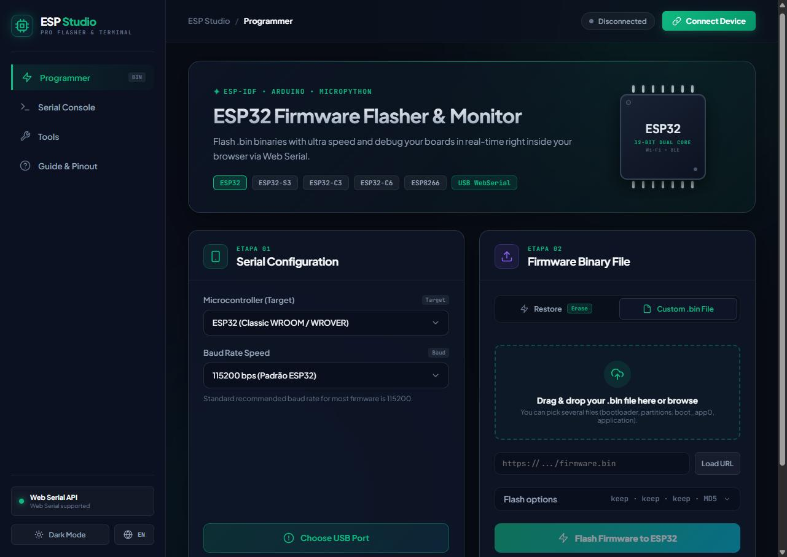
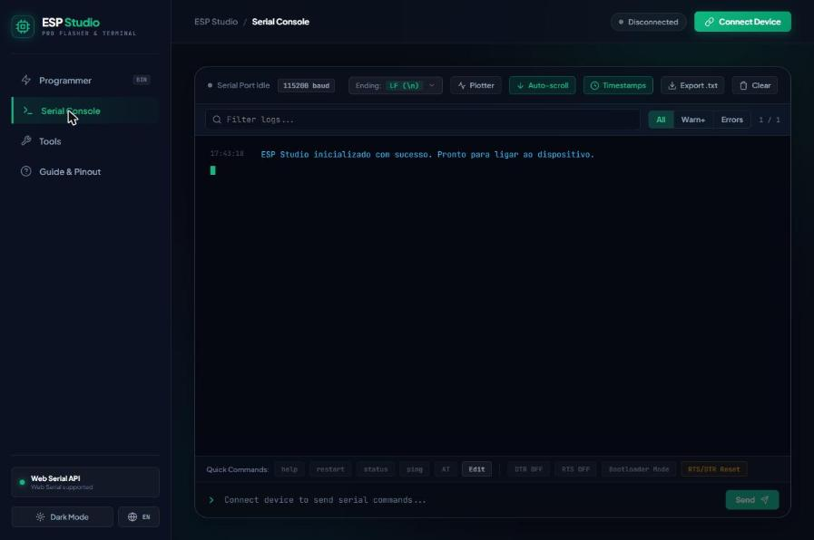
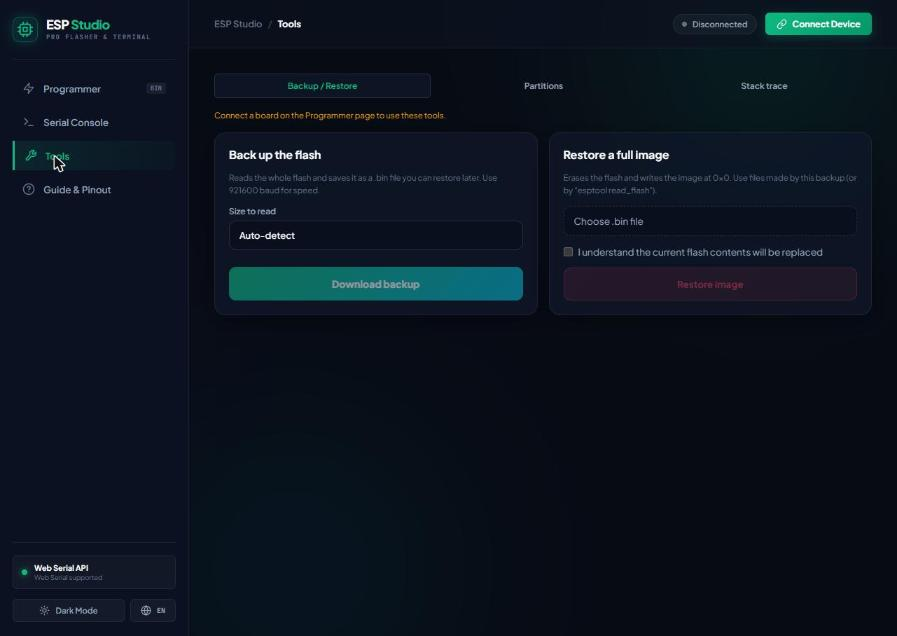
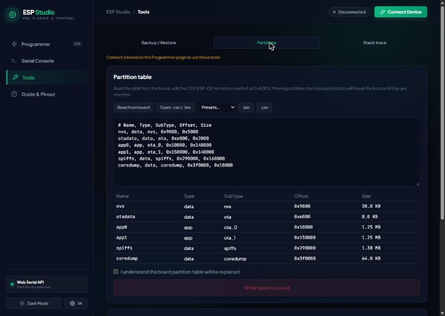

# ESP Studio

A browser-based flasher, serial monitor and toolbox for ESP32 and ESP8266 boards. It runs entirely in the page through the [Web Serial API](https://developer.mozilla.org/docs/Web/API/Web_Serial_API) and [esptool-js](https://github.com/espressif/esptool-js): nothing to install, and no firmware ever leaves your machine.



## Features

### Flashing
- Detects the chip, MAC address, crystal frequency and USB bridge by talking to the bootloader.
- Flash several images at once (bootloader, partition table, `boot_app0`, application), each with its own address. Addresses are guessed from common file names and checked for overlaps.
- Configurable flash mode, frequency and size, with automatic flash size detection and a fit-in-flash check.
- Optional MD5 verification after writing.
- Load firmware from a URL, or share a link that preloads it: `?fw=<url>&addr=<hex>` (repeat the pair for several files).
- Full chip erase.
- Reconnects and opens the serial monitor after flashing.

### Serial console
- Timestamps, auto-scroll, command history and selectable line endings.
- Text filter with highlighting, level filter (all / warnings / errors) and automatic highlighting of errors and panics.
- Editable quick commands, remembered between visits.
- Manual DTR/RTS toggles, reset and forced bootloader mode.
- Live serial plotter: send `25.4`, `1, 2, 3` or `temp:25.4,hum:40` and the values are charted. Pause, change the window and export to CSV.
- Export the log as text.



### Tools
- **Backup / restore:** read the whole flash into a `.bin` and write it back later.

  

- **Partitions:** read the partition table from the board, edit it as an ESP-IDF CSV (with validation of alignment, overlaps and flash bounds), and write it back. Write a prebuilt NVS, SPIFFS, LittleFS or FAT image to a partition, or download a partition.

  

- **Stack trace:** load the firmware `.elf` and paste a crash report to translate backtrace addresses into function names. Only function names are resolved; line numbers need `addr2line`.

### App
- Dark and light themes, Portuguese (PT-PT) and English.
- Installable as a PWA and usable offline once loaded.
- Settings (baud rate, line ending, flash options, quick commands…) are stored in the browser.

## Supported hardware

ESP32, ESP32-S2, ESP32-S3, ESP32-C2, ESP32-C3, ESP32-C6, ESP32-H2, ESP32-P4 and ESP8266, through any USB-serial bridge the browser can see (CP210x, CH340, FTDI, or the native USB of the S2/S3/C3/C6).

## Browser support

Web Serial is available in Chromium-based desktop browsers (Chrome, Edge, Opera, Brave). Firefox and Safari do not support it. The page must be served over HTTPS or from `localhost`.

## Getting started

```bash
npm install
npm run dev      # development server
npm run build    # production build in dist/
npm run preview  # serve the production build
```

Open the page, click **Connect Device**, pick the serial port, then choose your `.bin` files on the **Programmer** page.

## Project layout

```
src/
  App.vue                  main shell: connection, flashing, console
  components/              SerialPlotter and the Tools pages
  lib/                     MD5, flash image helpers, partition table, ELF reader,
                           log classification, plotter parser, storage
public/                    web manifest, icons and service worker
tools_blink/               PlatformIO sketch for a simple LED test firmware
docs/screenshots/          images used in this README
```

## Notes and limitations

- esptool-js rewrites the bootloader header incorrectly when asked to change flash parameters, so ESP Studio patches the header itself (and recomputes the appended SHA-256 digest). Leaving the options on **Keep** writes files untouched.
- Flash backups are read in 256 KB chunks because esptool-js becomes very slow on large single reads. Use a higher baud rate (921600) for large flashes.
- Loading a firmware from a URL requires the server to allow CORS, for example `raw.githubusercontent.com` or `cdn.jsdelivr.net`. GitHub release assets usually do not.
- Boards with native USB can re-enumerate after a reset; if the port cannot be reopened automatically, connect again.
- The flashing, reading and signal features were written against the esptool-js API and have not been exercised on every chip family.

## License

[MIT](LICENSE) © 2026 joaquim.org
